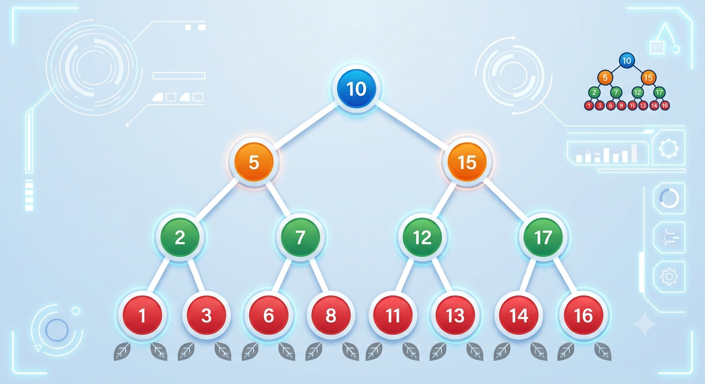
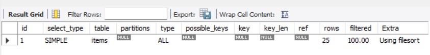
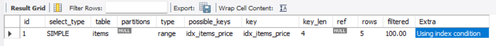
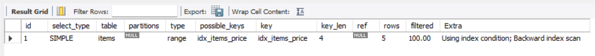
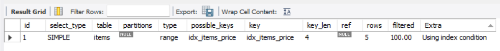

## 1. 데이터가 많아지면 같은 검색도 부담이 커질 수 있다

상품 이름으로 특정 데이터를 찾는 SQL은 테이블의 크기에 따라 처리해야 할 작업량이 달라질 수 있다. 처음에는 금방 결과가 나오더라도, 검색 대상이 수백만 건 이상으로 늘어나면 조회 과정에서 확인해야 하는 데이터가 많아진다.

이번 내용에서는 **검색할 위치를 좁힐 수 있는 정보가 없을 때** 어떤 일이 발생하는지부터 살펴봤다.

---

## 2. 조건에 맞는 행을 찾기 위해 전체를 확인하는 경우

**풀 테이블 스캔(Full Table Scan)** 은 테이블의 행을 훑으면서 검색 조건에 맞는 데이터를 판단하는 방식이다. 특정 상품 이름을 찾을 때 해당 값이 어디에 있는지 알 수 없다면 많은 행을 확인해야 할 수 있다.

전체 행을 대상으로 하는 탐색의 작업량은 `O(n)`으로 나타낼 수 있다. 여기서 `n`은 탐색 대상 데이터의 수다. 따라서 확인해야 할 행이 늘어날수록 비교 작업도 함께 증가한다.

다만 실제 조회에 걸리는 시간은 행의 수만으로 결정되지 않는다. 서버의 CPU와 메모리, 디스크 입출력, 데이터 크기와 실행 당시 부하 등이 영향을 주기 때문에 정확한 응답 시간을 단순히 계산할 수는 없다.

---

## 3. 검색할 값의 위치를 따로 관리하기

인덱스(`INDEX`)는 특정 컬럼을 기준으로 원하는 데이터를 찾는 데 활용하는 별도의 자료 구조다. 검색 대상 값과 원본 행을 찾아갈 수 있는 정보를 함께 관리한다.

이번에 학습한 인덱스의 중요한 특징은 **값을 정렬된 구조로 보관한다는 점**이다. 검색할 때 데이터의 위치를 처음부터 모두 확인하는 대신, 정리된 값을 이용해 필요한 행에 접근할 수 있다.

즉 인덱스를 이해할 때는 **검색할 값과 원본 데이터를 찾아갈 정보가 연결되어 있다**는 점이 핵심이다.

---

## 4. 값의 크기로 탐색 방향을 정하는 트리

인덱스의 검색 원리를 이해하기 위해 트리 구조를 살펴봤다. 트리는 노드 사이에 부모와 자식 관계가 있고, 맨 위의 노드를 루트(`root`)라고 한다.

자식 노드가 최대 두 개인 구조를 이진 트리라고 한다. 이 가운데 **이진 탐색 트리**는 현재 노드보다 작은 값을 왼쪽에, 큰 값을 오른쪽에 배치하는 규칙을 사용한다.

이 규칙에 따라 데이터를 찾을 때는 현재 노드와 검색 값을 비교한 뒤 어느 방향으로 이동할지 결정할 수 있다. 모든 노드를 순서대로 확인하는 것과는 다른 접근이다.



- 트리는 부모 노드와 자식 노드로 구성된다.
  => 여기서는 각 원이 노드다. 노드 안에는 데이터와 다음 노드들의 위치가 보관된다.
- 가장 높은 조상을 루트(root)라 한다. 이 그림을 뒤집어보면 왜 트리라고 하는지, 처음을 루트라고 하는지
  이해가 될 것이다.
- 자식이 2개까지 올 수 있는 트리를 **이진 트리**라 한다.
- 여기에 노드의 왼쪽 자손은 더 작은 값을 가지고, 오른쪽 자손은 더 큰 값을 가지는 것을 **이진 탐색 트리**라 한다.

**이진 탐색 트리 - 입력 예시**
이진 탐색 트리의 핵심은 데이터를 입력하는 시점에 정렬해서 보관한다는 점이다.
그리고 작은 값은 왼쪽에, 큰 값은 오른쪽에 저장한다.

사진을 참고해서 이진 탐색 트리에 대해서 알아보자.

먼저, 10을 입력했다고 가정하자.
다음으로 5, 15를 입력한다.
5는 10보다 작으니까 왼쪽 노드에 15는 10보다 크니까 오른쪽 노드에 배치한다.

그 다음에 2와 7을 입력하면 2는 10이랑 5보다 작으니까 왼쪽 노드에 7은 10보다 작으니까 일단 왼쪽 넣드에 배치하고 5보단 크니까
오른쪽 노드에 배치해야 한다.

이러한 과정으로 이진 탐색 트리 구조를 완성시킨다.
이미지를 참고해서 13이라는 데이터를 검색한다고 가정해보자.
- 1번 : 루트인 10과 비교한다. 10보다 크므로 오른쪽으로 찾아간다.
- 2번 : 15와 비교한 다음에 15보다 작으므로 왼쪽으로 찾아간다.
- 3번 : 12와 비교한 다음에 12보다 크므로 오른쪽으로 찾아간다.
- 4번 : 노드에 있는 값을 비교한다. 13과 같으므로 13을 찾는다.

데이터가 총 15개인데 단 4번의 계산만으로 필요한 결과를 얻을 수 있다.

---

## 5. 비교할 범위를 줄이는 검색 과정

이진 탐색 트리에서는 검색 값이 현재 노드보다 작은지, 큰지를 확인해 다음에 살펴볼 부분을 결정한다. 원본 예제에서도 루트부터 비교를 시작해 한쪽 자식으로 이동하는 과정을 반복했다.

탐색 대상이 단계마다 절반으로 줄어드는 경우에는 그 과정을 `O(log n)`으로 표현할 수 있다. 예를 들어 16개의 후보를 절반씩 줄이면 다음처럼 범위가 작아진다.

```text
16 → 8 → 4 → 2 → 1
```

이 예시에서 중요한 부분은 **전체 데이터를 하나씩 비교하는 대신, 각 비교를 통해 살펴볼 대상을 줄여 나간다**는 점이다.

---

## 6. 저장된 값을 순서대로 확인하는 방법

이진 탐색 트리는 값의 대소 관계에 맞춰 노드를 배치하므로, 방문하는 순서를 정해 정렬된 결과를 얻을 수도 있다.

이번에 다룬 방법은 **중위 순회(Inorder Traversal)** 다. 현재 노드를 기준으로 왼쪽에 있는 노드들을 먼저 방문하고, 현재 노드를 처리한 다음 오른쪽 노드들을 방문한다.

```text
왼쪽 부분 방문 → 현재 노드 처리 → 오른쪽 부분 방문
```

이진 탐색 트리의 규칙이 유지된 상태에서 이 순서로 방문하면 값들을 오름차순으로 확인할 수 있다.

**중위 순회 순서**
쉽게 이야기해서 자신의 왼쪽의 모든 노드를 처리하고, 자신의 노드를 처리하고, 자신의 오른쪽 모든 노드를 처리하는 방식이다.
첨부한 이미지에서 파란색 노드와 초록색 노드까지 있다고 가정해보자.

- 10의 기준에서 왼쪽 서브트리를 방문한다.
- 5의 기준에서 왼쪽 서브트리를 방문한다.
  => 2를 출력한다.
- 5 자신을 출력한다.
- 5의 기준으로 오른쪽 서브트리를 방문한다.
  => 7을 출력한다.
- 10 자신을 출력한다.
- 10의 기준에서 오른쪽 서브트리를 방문한다.
- 15의 기준에서 왼쪽 서브트리를 방문한다.
  => 12를 출력한다.
- 15 자신을 출력한다.
- 15의 기준에서 오른쪽 서브트리를 방문한다.
  => 17을 출력한다.
  순서대로 오름차순인 2, 5, 7, 10, 12, 15, 17이 출력된 것을 확인할 수 있다.

---

## 7. 탐색과 정렬 관점에서 이해한 핵심

이번 내용에서 풀 테이블 스캔은 검색 조건을 확인하기 위해 많은 행을 살펴봐야 할 수 있는 방식이었다. 반면 인덱스는 정리된 값과 원본 행을 찾을 정보를 이용해 탐색에 필요한 작업을 줄이는 데 목적이 있다.

또한 이진 탐색 트리를 통해 값의 크기를 기준으로 이동 방향을 선택하는 과정과, 중위 순회로 값을 순서대로 확인하는 방법을 이해했다.

내가 정리한 핵심은 **데이터를 어떤 구조로 관리하느냐에 따라 필요한 값을 찾는 과정이 달라진다**는 것이다.

---

## 8. 검색용 인덱스를 직접 관리하기

특정 컬럼으로 데이터를 자주 찾는다면 그 컬럼에 인덱스를 별도로 만들 수 있다. MySQL에서는 `CREATE INDEX`로 생성하고, `SHOW INDEX`로 현재 구성을 확인하며, 필요 없어진 인덱스는 `DROP INDEX`로 삭제한다.

### 인덱스 만들기

`CREATE INDEX`에는 인덱스 이름, 대상 테이블, 기준 컬럼을 지정한다. 여러 컬럼을 함께 지정하는 것도 가능하다. 이름은 어떤 테이블과 컬럼에 사용하는 것인지 알아보기 쉽게 정해두면 관리하기 편하다.

예를 들어 상품명으로 검색하는 경우를 위해 다음처럼 설정할 수 있다.

```sql
CREATE INDEX idx_items_item_name ON items (item_name);
```

생성 과정에서는 기존 컬럼 데이터를 바탕으로 인덱스 구조를 구성하므로, 데이터 양에 따라 시간이 걸릴 수 있다.

### 현재 인덱스 살펴보기

`SHOW INDEX FROM 테이블명`으로 해당 테이블의 인덱스 정보를 볼 수 있다.


`items` 조회 결과에서 확인할 항목은 다음과 같다.

- `Key_name`: 등록된 인덱스의 이름이다. 직접 만든 `idx_items_item_name`도 여기에 나타난다.
- `Column_name`: 인덱스가 대상으로 삼는 컬럼을 가리킨다.
- `Non_unique`는 인덱스의 중복 허용 여부를 나타낸다. `1`이면 중복을 허용하고, `0`이면 중복을 허용하지 않는 인덱스다.
- `Cardinality`는 인덱스에 존재하는 서로 다른 값의 개수를 추정한 수치다.

직접 생성하지 않았던 `PRIMARY`와 `fk_items_sellers`도 보인다. 기본 키인 `item_id`에 대한 인덱스와 외래 키인 `seller_id`에 필요한 인덱스가 이미 준비되어 있기 때문이다.

판매자 테이블에서도 인덱스를 확인해 봤다.


`sellers`에는 기본 키 `seller_id`를 위한 `PRIMARY` 인덱스와, `UNIQUE` 조건을 가진 `seller_name`의 인덱스가 표시된다. 중복을 허용하지 않는 조건은 새 값의 중복 여부를 검사해야 하므로 인덱스가 사용된다. 이번 실습에서는 **기본 키, 외래 키, UNIQUE 제약조건과 인덱스의 관계**를 함께 확인했다.

### 만들었던 인덱스 지우기

더 이상 필요하지 않은 인덱스는 쓰기 작업에 부담이 될 수 있어 삭제할 수 있다.

```sql
DROP INDEX idx_items_item_name ON items;
```

이처럼 인덱스를 생성하거나 삭제한 뒤, 쿼리가 실제로 어떤 경로로 데이터를 찾는지도 확인할 필요가 있다.

---

## 9. 실행 계획으로 인덱스 사용 여부 살펴보기

인덱스가 존재한다고 해서 조회할 때 반드시 사용되는 것은 아니다. MySQL의 옵티마이저는 쿼리 조건과 데이터 상태를 참고해 접근 방법을 고른다. 이 선택을 확인하는 명령어가 `EXPLAIN`이다.

### 상품명 인덱스가 없는 상태

상품명에 걸린 인덱스를 삭제한 후 동등 조건 조회의 실행 계획을 확인한 결과다.


- `type = ALL`: 테이블 전체를 읽는 접근 방식이 계획되어 있다.
- `key = NULL`: 선택된 인덱스가 없다.
- `rows = 25`: 읽을 것으로 예상하는 행이 25개다. 실제 처리 건수를 확정한 값은 아니다.
- `filtered = 10.00`: 읽은 행 중 조건을 만족할 것으로 예상하는 비율이 약 10%다.
- `Extra = Using where`: 조회 조건을 적용해 행을 걸러낸다는 뜻이다.

이 결과에서는 인덱스를 이용해 검색 대상을 바로 좁히지 않고, 테이블을 훑는 계획이 선택되었다.

### 상품명 인덱스를 다시 생성한 상태

상품명 컬럼의 인덱스를 다시 만든 후 같은 조건으로 실행 계획을 비교했다.


이전 결과와 달라진 항목에 집중해 보면 다음과 같다.

- `type = ref`: 인덱스를 이용한 동등 조건 접근이다.
- `possible_keys`: 이 쿼리에서 사용을 고려할 수 있는 인덱스 목록이다.
- `key = idx_items_item_name`: 실제 실행 계획에서 선택한 인덱스가 표시되었다.
- `rows = 1`: 탐색할 것으로 예상하는 행이 1개로 줄었다.
- `filtered = 100.00`: 읽은 행이 조건을 만족할 것으로 추정한 비율이다.
- 이번 실행 계획에서는 기존에 나타났던 `Using where`가 표시되지 않았다.

여기서 확인한 핵심은 **같은 조회 조건이라도 인덱스 유무에 따라 `ALL`과 `ref`처럼 접근 방식이 달라질 수 있다**는 점이다.

---

## 10. 값의 구간을 찾을 때도 인덱스가 쓰일까?

상품 가격이 일정 구간에 해당하는 데이터를 찾는 예제에서도 인덱스 적용 전후의 실행 계획을 비교했다.

### 가격 인덱스 없이 조회한 경우


가격 조건에 사용할 인덱스가 없으므로 `type`은 `ALL`, `key`는 `NULL`이었다. 예상 조회 행 수는 `25`, 예상 필터 통과 비율은 `11.11%`로 나타났으며, `Extra`에는 `Using where`가 표시되었다.

즉, 이 실습에서는 가격 구간을 찾기 위해 테이블 전체를 확인하는 계획이 선택되었다. 인덱스가 없는 상태에서 조회한 결과가 `item_id` 순서로 나타나더라도, 그것을 SQL의 정렬 보장으로 해석해서는 안 된다.

### 가격 인덱스를 추가한 경우

```sql
CREATE INDEX idx_items_price ON items (price);
```

그다음 동일한 구간 조건의 실행 계획을 살펴봤다.


- `type = range`: 인덱스에서 특정 범위에 해당하는 값을 찾아 접근한다.
- `key = idx_items_price`: 가격 컬럼에 만든 인덱스가 선택되었다.
- `rows = 5`: 확인할 것으로 추정하는 행 수가 기존 25개에서 5개로 바뀌었다.
- `filtered = 100.00`: 읽을 것으로 예상한 행 가운데 조건에 맞는 비율을 100%로 추정했다.
- `Extra = Using index condition`: 인덱스 조건을 활용해 원본 행을 가져오기 전에 조건을 검사하는 방식이 표시되었다.

이번 결과에서는 `ALL` 대신 `range`가 선택된 점이 가장 큰 차이다. 가격이 정렬된 인덱스를 통해 해당 구간만 탐색할 수 있기 때문이다.

### 결과가 보이는 순서에 관하여

실제 데이터 조회 결과를 비교한 이미지다.


인덱스를 사용한 뒤에는 가격 기준으로 정렬된 것처럼 결과가 나타났다. 이는 인덱스를 따라 읽는 과정과 관련이 있지만, **인덱스가 있다는 이유만으로 반환 순서가 보장되지는 않는다.** 가격순 결과가 필요할 때는 `ORDER BY price`를 명시해야 한다.

---

## 11. LIKE 조건에서 검색 시작 위치가 중요한 이유

문자열에 대한 `LIKE` 검색도 인덱스를 활용할 수 있다. 다만 `%`를 어디에 두는지에 따라 검색 범위를 정할 수 있는지가 달라진다.

- `LIKE '게이밍%'`: 문자열의 시작 부분이 정해져 있어 인덱스 범위 접근이 가능하다.
- `LIKE '%게이밍'`: 앞부분이 고정되지 않아 일반적인 인덱스 범위 탐색에 불리하다.
- `LIKE '%게이밍%'`: 문자열 앞부분을 알 수 없어 마찬가지로 인덱스를 활용하기 어렵다.

이번 실습에서 앞부분이 고정된 조건의 실행 계획은 `range`로 나타났다. 인덱스에 문자열이 순서대로 정리되어 있으므로, 특정 접두어로 시작하는 첫 위치를 찾고 그 접두어가 유지되는 항목들을 이어서 확인할 수 있다. 반대로 앞에 `%`가 붙으면 어디부터 확인해야 할지 정하기 어렵다.

정리하면 **문자열의 시작 부분을 특정할 수 있는지**가 이번 `LIKE` 인덱스 실습의 핵심이다.

---

## 12. 정렬할 때 인덱스가 사용되는 방식

`ORDER BY`는 조회한 데이터를 지정한 기준에 맞게 나열하는 구문이다. 정렬 대상이 많아지면 값들을 비교하고 순서를 정하는 과정에 추가적인 작업이 필요할 수 있다.

인덱스는 컬럼 값을 순서에 맞춰 관리하므로, 쿼리의 정렬 기준과 맞는 인덱스를 이용하면 별도로 결과를 정렬하는 과정을 줄일 수 있다.

### 인덱스를 이용하지 못한 정렬

`stock_quantity`를 기준으로 정렬한 쿼리의 실행 계획을 확인했다.



- `type = ALL`: 테이블 전체를 확인하는 접근 방법이다.
- `key = NULL`: 이번 실행 계획에서 선택한 인덱스가 없다.
- `Extra = Using filesort`: 조회 결과를 정렬하는 별도 작업이 필요하다는 의미다.

`filesort`는 이름과 달리 반드시 파일을 만들어 정렬한다는 뜻은 아니다. 정렬 처리에는 메모리나 디스크가 사용될 수 있다.

### 가격 인덱스를 이용해 정렬한 경우

이번에는 가격 범위를 조회하면서 같은 `price` 컬럼을 오름차순 정렬 기준으로 지정했다. 앞서 만들어 둔 `idx_items_price` 인덱스를 사용하는 상황이다.

```sql
SELECT * FROM items
WHERE price BETWEEN 50000 AND 100000
ORDER BY price;
```



- `type = range`: 인덱스의 특정 구간을 살펴보는 접근이다.
- `key = idx_items_price`: 가격 인덱스가 선택되었다.
- `Extra = Using index condition`: 인덱스에 있는 값을 이용해 조건을 확인한다.

이 실행 계획에서는 `Using filesort`가 보이지 않는다. 가격순으로 관리되는 인덱스에서 필요한 범위를 읽으면서 `ORDER BY price`의 순서까지 처리할 수 있기 때문이다.

또한 같은 범위 조건에서 `ORDER BY`를 생략했을 때도 실습 결과는 가격순으로 나타났다. 다만 **정렬 구문을 명시하지 않은 조회는 반환 순서를 보장하지 않는다.**

### 인덱스를 반대 방향으로 읽는 경우

가격이 높은 데이터부터 조회하는 `ORDER BY price DESC`에서도 기존 가격 인덱스를 사용할 수 있다.



이때 `Extra`에는 `Backward index scan`이 나타났다. 인덱스를 뒤쪽부터 읽어 가격이 높은 값에서 낮은 값으로 이동한다는 의미다.

따라서 이번 실행 계획에서는 내림차순 결과를 얻기 위해 `Using filesort`가 추가되지 않았다.

### 정렬 방향을 지정한 인덱스

MySQL 8.0부터는 인덱스를 생성할 때 내림차순 방향을 지정할 수 있다. 이번 실습에서는 기존 가격 인덱스를 삭제한 후 같은 이름으로 다시 생성했다.

```sql
CREATE INDEX idx_items_price ON items (price DESC);
```



동일한 가격 범위와 `ORDER BY price DESC` 조건으로 확인한 결과, `Backward index scan` 표시가 없어지고 `Using index condition`만 나타났다.

앞선 실행 계획에서는 오름차순 인덱스를 역방향으로 읽었지만, 내림차순 인덱스를 적용한 뒤에는 역방향 스캔 표시가 나타나지 않았다. 이는 인덱스의 정렬 방향과 조회 조건의 정렬 방향이 일치하기 때문이다. 두 경우 모두 별도의 `Using filesort`는 표시되지 않았다.

이번 내용에서 확인한 것은 **정렬 방향에 맞게 인덱스를 읽을 수 있다면, 데이터를 따로 정렬하는 작업을 생략할 수 있다는 점**이다.
