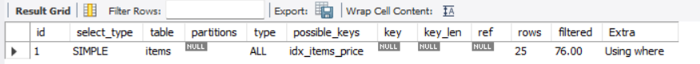
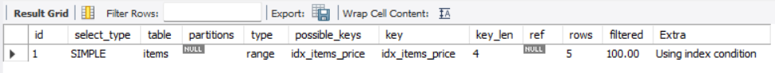
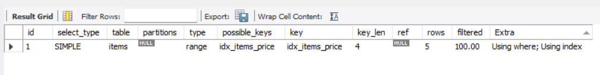
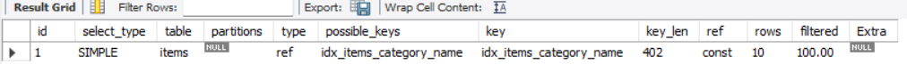
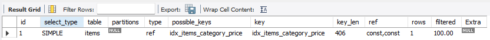
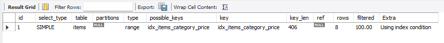

## 1. 인덱스를 만들어도 사용하지 않을 수 있다

특정 컬럼에 인덱스가 있어도 MySQL이 모든 조회에서 이를 선택하는 것은 아니다. **옵티마이저(Optimizer)** 는 실행 가능한 방법의 비용을 비교한 뒤 더 유리하다고 예상되는 방법을 고른다.

인덱스를 따라 필요한 행을 찾아가는 방식보다 테이블 전체를 읽는 방식이 낫다고 판단하면, 인덱스를 사용할 수 있어도 **풀 테이블 스캔**을 선택한다.

이번 실습에서는 `price`에 인덱스가 있는 상태에서 검색 구간을 다르게 지정하고 실행 계획을 비교했다.


가격 범위가 비교적 좁을 때는 `idx_items_price`를 이용하는 계획이 나타났다.



조회 범위를 크게 늘린 뒤에는 실행 계획이 달라졌다.

- `possible_keys`에 인덱스가 표시되어도 실제 사용을 뜻하지는 않는다.
- `key = NULL`은 선택된 인덱스가 없다는 뜻이다.
- `type = ALL`은 테이블 전체를 읽는 접근 방식이다.
- `filtered = 76.00`은 읽을 것으로 예상한 행 중 조건을 만족할 비율을 약 76%로 추정했다는 뜻이다.

즉, **인덱스의 존재 여부와 실제 사용 여부는 별개**이며, 선택된 방법은 `EXPLAIN`으로 확인해야 한다.

---

## 2. 읽어야 할 행이 많을 때 비용이 달라지는 이유

인덱스 검색에서는 먼저 인덱스를 탐색하고, 필요한 값이 인덱스에 없다면 원본 행에도 접근해야 한다. 이 과정에서 여러 위치의 데이터를 찾아 읽는 **랜덤 I/O**가 발생할 수 있다.

반면 풀 테이블 스캔은 데이터를 차례대로 읽는 **순차 I/O** 방식으로 설명할 수 있다. 서로 떨어진 위치를 반복해서 읽는 것과 연속된 영역을 읽는 것은 비용이 다를 수 있다.

따라서 조건에 맞는 행이 많아지면 인덱스에서 위치를 찾고 각 행을 읽는 것보다 테이블을 훑는 편이 유리해질 수 있다. 두 방식의 비용이 역전되는 지점을 **인덱스 손익분기점**이라고 이해했다.

원본 학습 내용에서는 전체 행의 약 20~25%를 하나의 참고 기준으로 다뤘다. 다만 이를 모든 테이블과 쿼리에 적용되는 고정 수치로 보지는 않는다.

또한 테이블에 행이 몇 개 없다면 인덱스를 거치는 과정 자체가 부담이 될 수 있다. 이런 경우 `EXPLAIN`에서 `ALL`이 보인다는 이유만으로 문제가 있다고 단정할 수 없다.

---

## 3. 인덱스만 읽어서 조회를 마치는 경우

일반적인 인덱스 조회에서는 검색 조건에 맞는 항목을 찾은 후, 인덱스에 없는 컬럼 값을 얻기 위해 테이블에 다시 접근할 수 있다.

**커버링 인덱스(Covering Index)** 는 해당 쿼리에 필요한 값을 인덱스에서 모두 얻을 수 있는 경우를 가리킨다. 이때는 원본 테이블에서 추가로 컬럼을 읽지 않아도 된다.

`items` 테이블의 `price` 인덱스를 이용해 `item_id`, `price`, `item_name`을 조회하는 상황을 살펴봤다.



실습에서 사용한 `idx_items_price`에는 `price`와 기본 키인 `item_id`를 이용할 수 있지만, `item_name`은 포함되어 있지 않았다. 따라서 상품명까지 가져오려면 테이블의 데이터가 추가로 필요했다.

반대로 `item_name`을 제외하면 필요한 컬럼이 인덱스에 모두 존재한다.



이번 결과의 `Extra`에 나타난 **`Using index`** 는 필요한 데이터를 인덱스만으로 조회할 수 있음을 보여준다. 같은 컬럼의 인덱스를 쓰더라도 **어떤 컬럼을 SELECT 하느냐에 따라** 커버링 여부가 달라진다.

---

## 4. 조회에 필요한 컬럼을 함께 인덱스로 관리하기

상품명까지 필요한 조회를 인덱스만으로 처리하려면, 인덱스에 `item_name`도 포함시키는 방법을 생각할 수 있다.

```sql
CREATE INDEX idx_items_price_name ON items (price, item_name);
```

이 인덱스는 `price`를 먼저 기준으로 삼고, 가격이 같은 항목 안에서는 `item_name`을 기준으로 값을 관리한다. 이번 실습에서 사용한 보조 인덱스에는 기본 키 값도 포함되므로, `item_id`, `price`, `item_name`을 인덱스에서 조회할 수 있다.

다만 컬럼을 더 넣어 인덱스를 구성하면 그만큼 저장 공간을 사용한다. 또한 데이터가 추가·변경·삭제될 때 인덱스도 관리해야 하므로 쓰기 작업에 부담이 생길 수 있다.

따라서 커버링 인덱스는 **조회에 필요한 데이터를 줄여 읽는 이점**과 **인덱스를 유지하는 비용**을 함께 생각해야 한다. 모든 조회에 무조건 적용하는 방법은 아니다.

---

## 5. 여러 컬럼을 하나의 인덱스로 묶는 이유

검색할 때 한 컬럼이 아니라 여러 조건을 함께 사용하는 경우가 있다. 이때 두 개 이상의 컬럼을 묶어 하나의 인덱스를 만드는 것이 **복합 인덱스(Composite Index)** 다.

예를 들어 `(category, price)` 순서로 인덱스를 구성하면 `category`가 먼저 정리되고, 같은 카테고리 안에서 `price`가 정렬된다.

이 순서 때문에 `category`를 지정한 뒤 해당 범위에서 가격을 찾는 방식과, `price`만 가지고 찾는 방식은 서로 다르다. 가격 값은 각 카테고리 안에서 정렬되어 있지만, **인덱스 전체가 가격 하나만을 기준으로 정렬된 것은 아니기 때문**이다.

복합 인덱스에서 앞쪽 컬럼부터 활용하는 규칙을 **왼쪽 접두어 규칙**이라고 한다. `(A, B, C)`로 만들었다면 이번 학습에서 다룬 기본적인 활용 형태는 `(A)`, `(A, B)`, `(A, B, C)`다. 앞부분을 제외한 컬럼만으로는 같은 방식의 탐색에 활용하기 어렵다.

---

## 6. 첫 번째 컬럼과 두 번째 컬럼의 조건 비교

실습에서는 다음 순서로 복합 인덱스를 생성했다.

```sql
CREATE INDEX idx_items_category_price ON items (category, price);
```

먼저 카테고리만 조건으로 지정한 실행 계획이다.



- `key`에는 생성한 `idx_items_category_price`가 표시되었다.
- `type = ref`로 나타났고, `rows`는 약 10개로 추정되었다.

이는 첫 컬럼인 `category`를 기준으로 해당 값의 구간을 찾아 읽는 경우다.

이번에는 카테고리와 가격을 모두 동등 조건으로 사용했다.



실행 계획은 `ref`였고 예상 행 수가 `1`로 나타났다. 첫 번째 컬럼으로 범위를 정한 다음, 그 안에서 정렬되어 있는 두 번째 컬럼의 값까지 조건에 이용한 결과다.

두 결과를 비교하면서 **복합 인덱스는 컬럼의 배치 순서가 중요하다**는 점을 확인했다.

---

## 7. 복합 인덱스로 정렬 작업까지 처리하기

복합 인덱스의 순서는 검색뿐 아니라 `ORDER BY`에도 영향을 준다.

이번에는 `category`를 하나의 값으로 제한하고, 일정 가격보다 높은 상품을 가격순으로 조회했다. `(category, price)` 인덱스에서 같은 카테고리에 속한 항목은 이미 가격순으로 관리되고 있다.



실행 계획의 `Extra`에는 별도의 정렬을 뜻하는 `Using filesort`가 표시되지 않았다. 이번 쿼리에서는 인덱스를 읽는 순서를 정렬에도 활용할 수 있었기 때문이다.

정리하면, 복합 인덱스는 **어떤 컬럼을 먼저 배치했는지**에 따라 검색 범위를 줄이는 방법과 정렬에 활용할 수 있는지가 달라진다.
