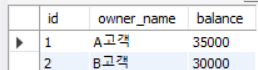

## 1. 여러 SQL 문을 하나의 작업으로 생각해야 하는 경우

데이터베이스에서 하나의 기능을 처리할 때 SQL 문이 여러 번 실행될 수 있다.

예를 들어 상품 주문에는 주문 내역을 추가하는 작업과 남은 재고를 수정하는 작업이 함께 필요하다. 주문 내역만 저장되고 재고 변경이 실패한다면 두 테이블이 서로 맞지 않는 상태가 된다.

이처럼 따로 실행하는 SQL 문이라도 하나의 업무를 완성하기 위해 모두 필요한 경우가 있다. **트랜잭션(Transaction)** 은 관련된 데이터 변경을 하나의 작업 단위로 묶어 관리하는 방법이다.

핵심은 **전체 작업을 확정하거나, 확정하지 않고 취소하는 것**이다. 중간 단계까지만 반영된 상태가 남지 않도록 하는 데 목적이 있다.

---

## 2. 변경한 내용을 확정할지 취소할지 정하기

트랜잭션을 직접 다룰 때 사용하는 명령어는 다음과 같다.

| 명령어 | 역할 |
| --- | --- |
| `START TRANSACTION` | 여러 SQL 문을 하나의 트랜잭션으로 실행하기 시작한다. |
| `COMMIT` | 현재 트랜잭션에서 변경한 내용을 확정한다. |
| `ROLLBACK` | 아직 확정하지 않은 현재 트랜잭션의 변경을 취소한다. |

계좌이체를 예로 들면, 한 계좌의 잔액을 줄이는 일과 다른 계좌의 잔액을 늘리는 일이 함께 이루어져야 한다.

```sql
START TRANSACTION;

UPDATE accounts SET balance = balance - 10000 WHERE id = 1;
UPDATE accounts SET balance = balance + 10000 WHERE id = 2;

COMMIT;
```

두 변경을 확인한 뒤 `COMMIT`하면 이체 결과가 확정된다. 반대로 작업 도중 잘못된 내용을 발견했다면, 확정하기 전에 `ROLLBACK`하여 이번 트랜잭션에서 변경한 값을 되돌릴 수 있다.

### 확정 전에는 값이 바뀌어 보일 수도 있다

트랜잭션 안에서 `UPDATE`한 후 같은 세션에서 조회하면, `COMMIT` 전이어도 변경한 값이 보인다.



위 실습에서는 계좌 잔액이 잠시 변경된 상태를 확인했지만, `ROLLBACK`한 뒤에는 해당 트랜잭션의 변경이 취소된다.

### MySQL에서 자동으로 확정되는 경우

MySQL에서는 기본적으로 `autocommit`이 활성화되어 있다. 별도로 트랜잭션을 시작하지 않으면 각 SQL 문이 성공적으로 실행될 때 자동으로 확정된다.

따라서 여러 변경을 한 번에 확정하거나 취소하려면 `START TRANSACTION`으로 작업 범위를 직접 지정해야 한다.

---

## 3. 트랜잭션을 신뢰할 수 있게 하는 네 가지 기준

트랜잭션의 주요 특성은 **ACID**라는 네 가지 개념으로 정리할 수 있다.

### 원자성(Atomicity): 일부만 끝난 결과를 남기지 않는다

계좌이체에서 출금과 입금은 함께 완료되어야 한다. 한쪽만 처리되었다면 전체 변경을 취소할 수 있어야 한다.

즉, 하나의 트랜잭션으로 묶은 작업을 부분적으로만 확정하지 않는 성질이다.

### 일관성(Consistency): 정해진 데이터 규칙을 유지한다

작업 전후의 데이터가 지켜야 할 조건을 위반하지 않아야 한다는 뜻이다.

예를 들어 계좌 간 돈을 옮기는 작업이라면 정상적으로 이체했을 때 두 계좌의 합계가 달라지지 않아야 한다. 잔액에 허용 범위를 지정하는 제약 조건 역시 데이터의 규칙을 유지하는 수단이다.

### 격리성(Isolation): 동시에 처리하는 작업의 영향을 구분한다

여러 트랜잭션이 같은 데이터를 다룰 때, 다른 트랜잭션이 진행 중인 변경을 어떻게 볼 수 있는지와 관련된 성질이다.

예를 들어 이체가 확정되지 않은 상태에서 다른 작업이 잔액을 조회하면, 중간에 변경된 값을 읽는 문제가 생길 수 있다. 이러한 상황을 어느 정도까지 막을지는 트랜잭션 격리 수준과 연결된다.

### 지속성(Durability): 확정한 결과를 유지한다

`COMMIT`으로 완료한 변경은 이후 시스템에 장애가 발생하더라도 보존되어야 한다.

따라서 작업 중인 값과 확정된 값은 구분해서 생각해야 한다.

---

## 4. 동시에 조회할 때 결과가 달라지는 상황

여러 트랜잭션이 같은 데이터에 접근하면 조회 시점에 따라 서로 다른 결과를 볼 수 있다. 강의에서 다룬 대표적인 문제는 다음 세 가지다.

### 확정되지 않은 변경을 읽는 경우: Dirty Read

다른 트랜잭션이 값을 변경했지만 아직 `COMMIT`하지 않은 상태에서 그 값을 읽는 문제다.

나중에 변경한 쪽이 `ROLLBACK`한다면, 조회한 쪽은 결국 취소된 값을 사용한 셈이 된다.

### 같은 행을 다시 읽었는데 값이 달라진 경우: Non-Repeatable Read

하나의 트랜잭션에서 같은 데이터를 두 번 조회하는 사이, 다른 트랜잭션이 해당 값을 수정하고 확정하면 이전과 다른 값을 읽을 수 있다.

예를 들어 처음에는 재고가 10개였지만 다시 조회했을 때 9개로 나타나는 상황이다.

### 같은 조건으로 조회했는데 행이 늘어난 경우: Phantom Read

동일한 검색 조건으로 다시 조회했을 때 이전에 없던 행이 나타나는 문제다.

예를 들어 특정 카테고리의 상품을 조회한 뒤 다른 트랜잭션이 그 카테고리에 상품을 새로 등록하고 확정하면, 같은 조건의 조회 결과에 행이 추가될 수 있다.

---

## 5. 트랜잭션끼리 어느 정도 분리할지 선택하기

격리 수준(Isolation Level)은 동시에 실행되는 트랜잭션이 서로의 변경 결과를 볼 수 있는 범위를 정하는 기준이다.

일반적으로 격리를 강화하면 동시 처리에 제약이 커질 수 있으므로, 데이터의 정확성과 처리 성능을 함께 고려한다.

| 격리 수준 | Dirty Read | Non-Repeatable Read | Phantom Read |
| --- | --- | --- | --- |
| `READ UNCOMMITTED` | 허용 | 허용 | 허용 |
| `READ COMMITTED` | 방지 | 가능 | 가능 |
| `REPEATABLE READ` | 방지 | 방지 | 표준상 가능 |
| `SERIALIZABLE` | 방지 | 방지 | 방지 |

위 표는 일반적인 격리 수준을 정리한 것으로, 데이터베이스에 따라 실제 동작은 다를 수 있다.

### READ UNCOMMITTED

확정되지 않은 변경을 다른 트랜잭션이 읽을 수도 있는 가장 낮은 격리 수준이다.

### READ COMMITTED

다른 트랜잭션에서 `COMMIT`한 변경만 읽도록 하여 Dirty Read를 방지한다. 다만 같은 데이터를 다시 조회했을 때 값이 달라질 가능성은 남아 있다.

### REPEATABLE READ

같은 트랜잭션에서 반복 조회할 때 일관된 결과를 유지하며, MySQL InnoDB의 기본 격리 수준이다. Phantom Read는 표준상 가능하지만, MySQL의 일반적인 `SELECT`에서는 같은 조회 결과가 유지된다.

### SERIALIZABLE

네 단계 중 가장 엄격한 격리 수준으로, 트랜잭션을 순차적으로 처리한 것과 같은 결과를 보장하는 데 목적이 있다. 그만큼 동시 처리에 제한이 생길 수 있다.

---

## 6. 이번에 정리한 내용

트랜잭션은 여러 데이터 변경이 하나의 업무에 속할 때, 일부만 확정되는 상황을 방지하기 위한 단위다.

`START TRANSACTION`으로 작업을 묶고 `COMMIT` 또는 `ROLLBACK`으로 결과를 정리할 수 있다. 이 과정에서 ACID는 트랜잭션이 갖추어야 할 특성을 설명하고, 격리 수준은 여러 트랜잭션을 동시에 실행할 때 발생할 수 있는 읽기 문제를 구분하는 기준이 된다.

따라서 **트랜잭션으로 무엇을 함께 처리할지**와 **동시 실행 중 어떤 조회 결과를 허용할지**를 나누어 이해하는 것이 중요하다.


